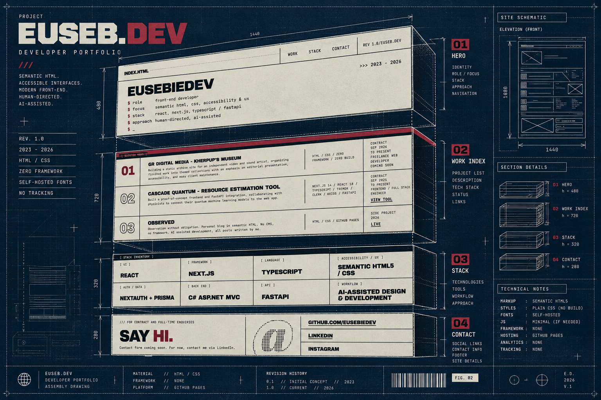

# EusebieDev Portfolio



A developer portfolio built around semantic HTML, CSS, accessible interfaces, and selected full-stack work.

Static site in vanilla HTML and CSS. No framework, no build step, no JavaScript. The design is Swiss Industrial Print: paper and ink with one oxblood accent, a 1px blueprint grid, rigid section rules, and a short terminal-style hero that types in with CSS only.

No analytics, trackers, or third-party requests.

**Status:** Some content and project links are still placeholders while the related work is in active development. The contact form is a disabled scaffold; LinkedIn is the current contact route.

## Local preview

No install step. From the repository root:

```sh
python3 -m http.server 8000 --bind 0.0.0.0
```

Open [http://localhost:8000](http://localhost:8000).

Serve over HTTP rather than opening `index.html` with `file://` so asset paths and self-hosted fonts behave like production. Stop the server with `Ctrl+C` when finished.

## Files

```text
index.html              hero, work index, stack inventory, contact
assets/
├── css/
│   └── style.css       all styles
├── fonts/              self-hosted WOFF2 fonts
└── images/             profile image and blueprint artwork
```

Fonts: Archivo Black, JetBrains Mono, and Playfair Display, licensed under the SIL Open Font License.

## Design artifact

The blueprint above is a stylized assembly drawing of the portfolio system rather than a literal screenshot. It treats the page as an engineered set of sections: identity, work index, stack inventory, contact, and footer.

## License

All rights reserved. See [LICENSE](LICENSE).
